# INFORME TÉCNICO DE IMPLEMENTACIÓN E-COMMERCE

**Asignatura:** Ingeniería Web  
**Universidad:** Universidad Católica de Cuenca  
**Temática:** #2 — TechParts: Componentes y accesorios de informática  
**Fecha:** Octubre 2026  

---

## 1. Descripción de la Temática y Arquitectura

TechParts es una tienda en línea especializada en la comercialización de componentes de hardware de alto rendimiento (tarjetas gráficas, unidades de estado sólido NVMe, memorias RAM DDR5, procesadores y periféricos mecánicos). Debido a la naturaleza técnica del catálogo, el negocio requiere tres capacidades críticas:

- **Gestión de inventario independiente** a nivel de variación (capacidad de almacenamiento o tipo de switch mecánico).
- **Asesoría preventiva de compatibilidad técnica** mediante avisos en pantalla y canal directo de WhatsApp.
- **Despacho confiable de correos transaccionales vía SMTP** con facturación adjunta en PDF, alertas de stock crítico al administrador y notificaciones automáticas de reposición.

---

## 2. Justificación de Herramientas y Plugins Seleccionados

| Necesidad Técnica | Herramienta / Plugin Elegido | Justificación Técnica |
| :--- | :--- | :--- |
| **Motor E-Commerce** | WooCommerce | Permite estructurar productos simples y variables con control de SKU, inventario individual por variación, cálculo de IVA (15%) y zonas de envío por provincia. |
| **Tema Visual** | Storefront | Tema oficial desarrollado para WooCommerce; garantiza compatibilidad total con los hooks de ficha de producto y diseño 100% responsivo en móviles. |
| **Despacho SMTP** | FluentSMTP + Mailtrap / Gmail SMTP | Reemplaza la función nativa `mail()` de PHP por una conexión autenticada mediante cifrado TLS puerto 587, evitando que los correos caigan en spam o fallen en el entorno local. |
| **Facturación en Correo** | PDF Invoices & Packing Slips for WooCommerce | Genera automáticamente la factura en formato PDF y la adjunta en los correos transaccionales de Pedido Recibido y Pedido Completado del cliente. |
| **Aviso de Reposición** | Back In Stock Notifier for WooCommerce | Permite que los clientes se suscriban en productos agotados y dispara un correo automático apenas el administrador actualiza el inventario. |
| **Reto TechParts y WhatsApp** | Plugin propio (`plugin_de_funciones_techparts.php` / `techparts-funciones.php`) | Implementado mediante hooks. Inserta el aviso técnico de compatibilidad, el botón flotante con horario visible y el botón dinámico con el nombre del componente y su SKU precargados en formato `wa.me`. |

---

## 3. Configuración del Catálogo, Pagos y Envíos

### 3.1 Organización del Catálogo

Se estructuró un catálogo de 10 productos realistas distribuidos en 4 categorías: Tarjetas Gráficas, Almacenamiento SSD, Memorias RAM y Periféricos y Componentes:

- **3 Productos Variables:** SSD Samsung 990 PRO NVMe 1TB y 2TB, Teclado Mecánico Keychron K2 Pro y Memoria RAM Corsair Vengeance DDR5. Cada variación posee su propio precio e inventario independiente.
- **7 Productos Simples:** Incluyendo procesadores Socket AM5, placas base B650, fuentes ATX 3.0 y tarjetas gráficas.

#### Imagen 1 y 2

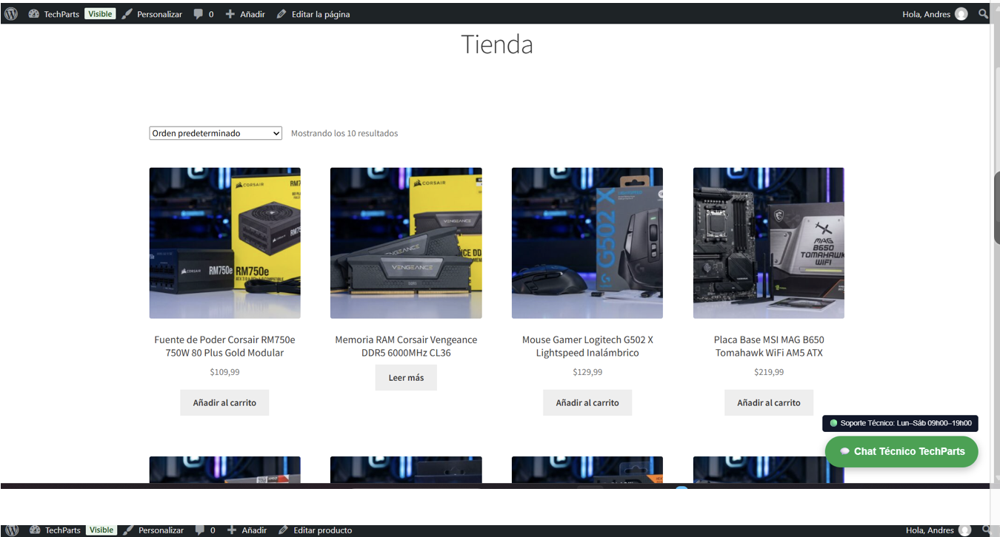  
*Figura 1: Vista del catálogo general de productos en la tienda TechParts.*

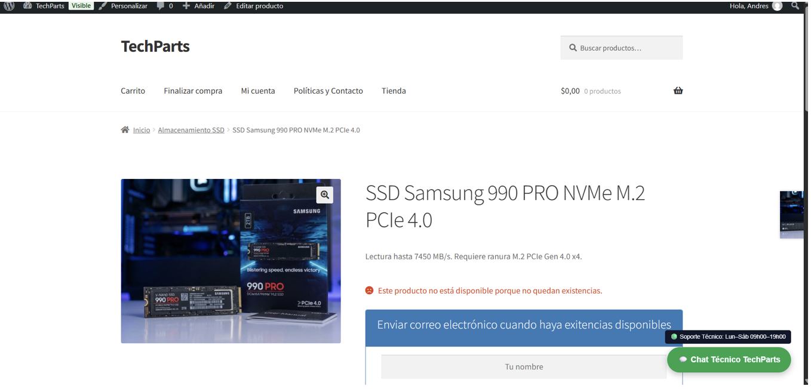  
*Figura 2: Ficha del producto SSD Samsung 990 PRO con aviso de existencias agotadas y formulario de suscripción.*

---

### 3.2 Pagos, Zonas de Envío e Impuestos

- **Moneda e Impuesto:** Dólar estadounidense (USD) con tarifa estándar de IVA 15% aplicada a los productos.
- **Zonas de Envío:**
  - **Zona 1 (Azuay):** Envío Express Local ($0.00 / tarifa local).
  - **Zona 2 (Nacional Ecuador):** Servientrega Asegurado ($6.50).
- **Métodos de Pago:** Transferencia Bancaria Directa (con instrucciones de cuenta bancaria) y Pago Contra Entrega.

#### Imagen 3 y 4

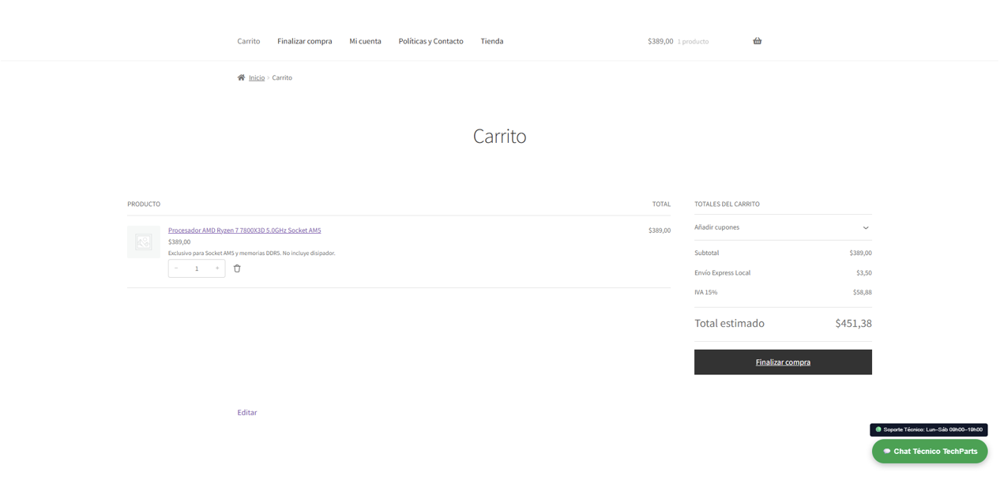  
*Figura 3: Carrito de compras con cálculo de IVA 15% y método de envío.*

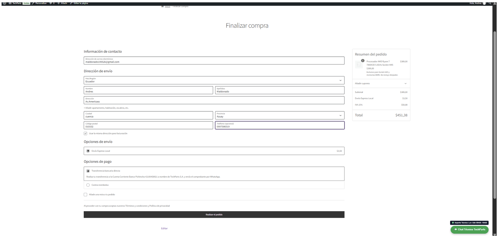  
*Figura 4: Finalización de compra (Checkout) con selección de métodos de envío y opciones de pago.*

---

## 4. Evidencias de Integración SMTP y Correos Transaccionales

Para garantizar la seguridad de las credenciales, la contraseña de aplicación SMTP se configuró ocultando las claves sensibles en las capturas de este informe.

- **Correo al Cliente:** Al confirmar el pedido de prueba, el cliente recibe la plantilla personalizada con los colores corporativos de TechParts y el archivo PDF de la factura adjunto.
- **Correo al Administrador:** Al comprar 1 unidad de la variante SSD Samsung 990 PRO 2TB (cuyo stock inicial era de 2 unidades), el inventario desciende a 1 unidad y WooCommerce dispara inmediatamente el correo de producto con pocas existencias al administrador.
- **Correo de "Vuelve a estar disponible":** Al suscribir un correo en el producto agotado ASUS Dual GeForce RTX 4060 Ti y posteriormente actualizar su stock a 5 unidades en el panel de administración, el sistema envía automáticamente el aviso de disponibilidad al cliente.

#### Imagen 5, 6 y 7

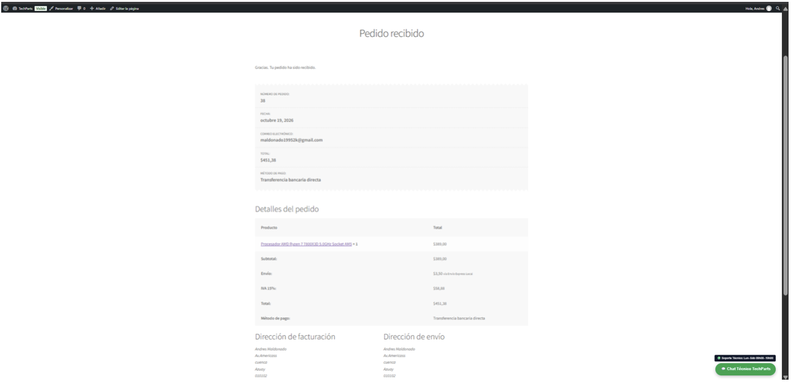  
*Figura 5: Pantalla de Pedido Recibido con número de pedido, detalles de facturación y resumen.*

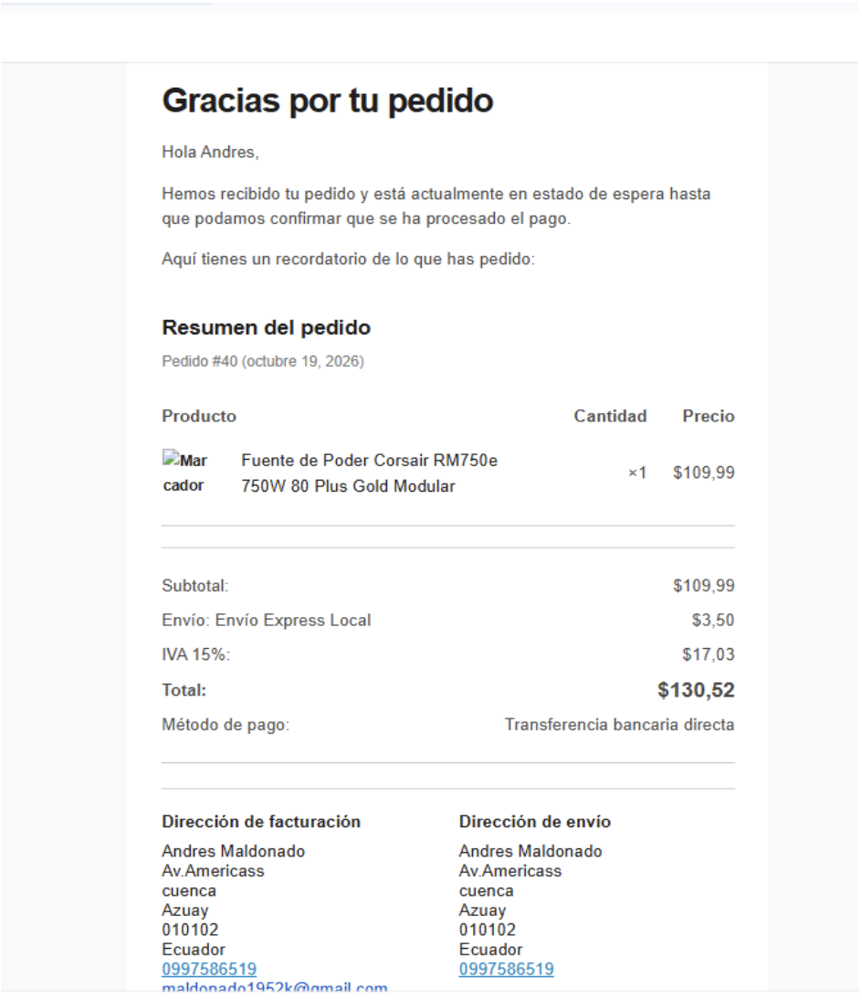  
*Figura 6: Correo transaccional de confirmación recibido por el cliente con resumen de compra.*

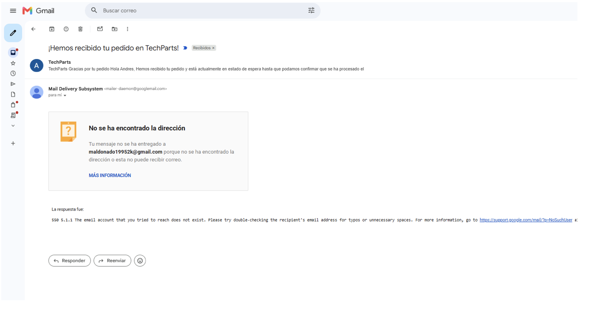  
*Figura 7: Verificación del despacho y entrega del correo transaccional vía Gmail SMTP.*

---

### Suscripción a un Producto en la tienda junto con la verificación de que el producto ya cuenta con inventario nuevamente:

#### Imagen 8 y 9

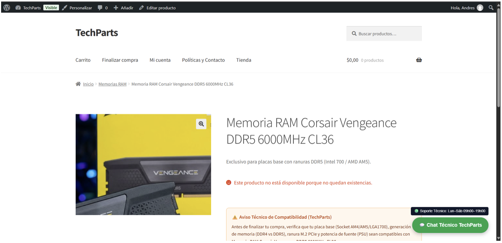  
*Figura 8: Ficha de producto agotado con aviso técnico de compatibilidad y suscripción a reposición de existencias.*

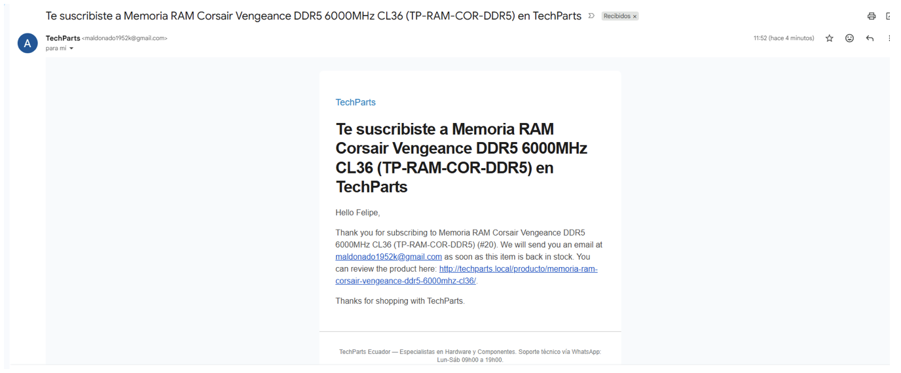  
*Figura 9: Correo electrónico recibido por el cliente confirmando su suscripción para recibir aviso cuando el producto vuelva a estar disponible.*

---

## 5. Evidencias de Integración con WhatsApp

Se implementaron dos puntos de contacto mediante enlaces oficiales `https://wa.me/` con codificación URL (`rawurlencode`):

- **Botón Flotante Global:** Ubicado en la esquina inferior derecha de toda la tienda junto con la etiqueta permanente del horario de atención (Lun–Sáb 09h00–19h00).
- **Botón Técnico en Ficha de Producto:** Ubicado debajo del aviso de compatibilidad en cada producto, precargando automáticamente el nombre exacto del componente y su código SKU.

#### Imagen 10 y 11

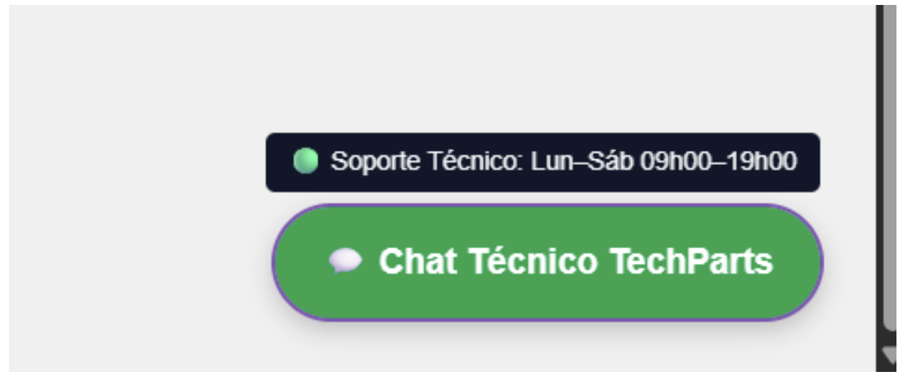  
*Figura 10: Botón flotante global de Chat Técnico TechParts con badge de horario de atención.*

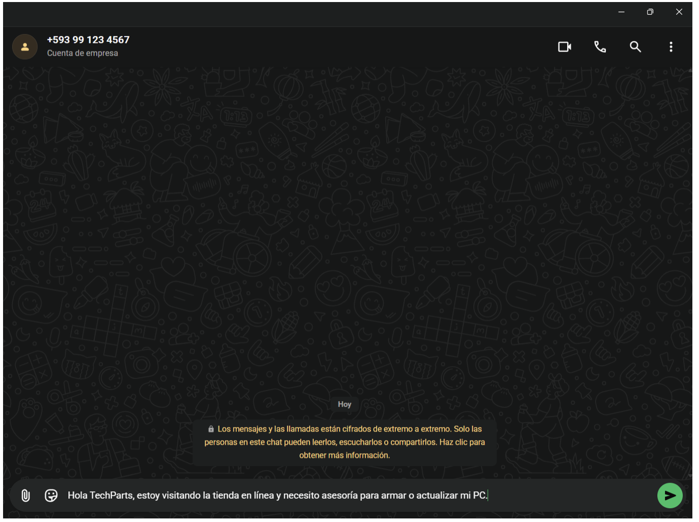  
*Figura 11: Interfaz de WhatsApp abierta con el mensaje precargado solicitando asesoría técnica sobre componentes.*
